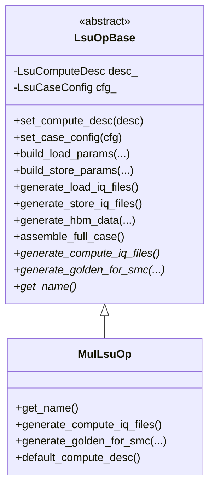

# AIACC `load_store_v2` 框架详解（Mul 示例）

本文基于以下源码逐行/逐段解读：

- `load_store_v2/lsu_op_base.h`
- `load_store_v2/lsu_op_base.cpp`
- `load_store_v2/mul/mul_lsu_op.h`
- `load_store_v2/mul/mul_lsu_op.cpp`
- `load_store_v2/gen_mul_lsu_case.cpp`

---

## 1. 架构总览图

### 1.1 类继承关系



### 1.2 数据流（Case 生成）

```mermaid
flowchart LR
    A[LsuComputeDesc.inputs/output] --> B[generate_load_iq_files]
    A --> C[generate_store_iq_files]
    D[MulLsuOp.generate_compute_iq_files] --> E[compute IQ files]
    B --> F[assemble_full_case]
    C --> F
    E --> F
    F --> G[smc_0/iq_*.hex]
    F --> H[smc_x/ur_data/bank*.hex 全零]
    F --> I[hbm_init_dir/memory_init{smc+1}.hex]
    F --> J[smc_x/output_bank/bank{output.bank}_final.hex]
```

### 1.3 HBM 地址布局（逻辑窗口 vs 实际初始化数据）

```mermaid
flowchart TB
    subgraph Logical_GR_Base_Window[逻辑 GR 基址窗口]
      L0[input0: base=0]
      L1[input1: base=(wc0+1)*16]
      L2[input2: base=(wc0+1+wc1+1)*16]
      LS[store: base=Σ(wci+1)*16]
    end

    subgraph HBM_Init_Data[实际 memory_init 数据]
      P0[input0: wc0*16 bytes]
      P1[input1: 紧接 input0]
      P2[input2: 紧接 input1]
      PN[... 无显式 gap]
    end
```

关键点：

- `gr_base` 采用 `(word_count + 1) * 16` 做段间偏移（逻辑窗口里每段多预留 1 line）。
- `generate_hbm_data()` 只按 `word_count * 16` 连续生成，不写入显式 gap。
- 因此是“**地址窗口保守预留 + 数据文件紧密排布**”。

---

## 2. `lsu_op_base.h` 逐行解读

### 2.1 文件定位

- 定义 v2 框架的核心数据结构与抽象基类。
- v2 的核心升级：把固定双输入改为 `map<string, PortInfo>` 的 N 输入泛化。

### 2.2 逐行分段说明

| 行号 | 说明 |
|---|---|
| 1-2 | 头文件保护宏。 |
| 4-10 | 引入基础类型、容器、LSU 发码接口与统一 IQ 文件描述。 |
| 12-13 | 命名空间 `aiacc::lsu`。 |
| 15-19 | `PortInfo`：单端口布局（bank / word 偏移 / word 数）。 |
| 21-28 | `LsuComputeDesc`：N 输入 + 输出 + 多 SMC 地址窗口参数。 |
| 30-35 | `LsuCaseConfig`：case 输出目录、HBM init 输出目录、随机种子。 |
| 37-76 | `LsuOpBase` 抽象基类接口定义。 |
| 78-81 | 命名空间与头文件结束。 |

### 2.3 结构体详解

#### `PortInfo`

| 字段 | 类型 | 含义 |
|---|---|---|
| `bank` | `uint8_t` | UR bank 编号（0~7）。 |
| `word_offset` | `uint16_t` | 该 bank 内起始 word 地址。 |
| `word_count` | `uint16_t` | 参与本次算子的 word 数，默认 255。 |

#### `LsuComputeDesc`

| 字段 | 类型 | 含义 |
|---|---|---|
| `inputs` | `map<string, PortInfo>` | 输入端口集合，key 是语义名（如 `input`/`other`/`bias`），value 是端口布局。 |
| `output` | `PortInfo` | 输出端口布局。 |
| `num_smc` | `uint8_t` | 参与生成的 SMC 数量。 |
| `smc_id_en` | `uint8_t` | 写入 LSU IQ 的 SMC 使能/参与位字段（默认 `7`，覆盖低 3 位场景）。 |
| `gr_intlv_addr` | `uint64_t` | SMC 地址分窗步长（默认 `0x10000000`）。 |

`inputs` 的设计意图（重点）：

1. **端口数量解耦**：不再限制只能 `input/other` 两个输入，可扩成 1~N 输入算子。
2. **语义解耦**：用字符串 key 表示语义角色（如 `lhs/rhs/scale`），子类可按 key 取所需输入。
3. **遍历驱动生成**：Load 指令与输入切片逻辑可直接遍历 `inputs` 自动扩展。
4. **可复用框架**：`LsuOpBase` 不需要知道具体算子，仅通过 map + 虚函数完成组装。
5. **确定性顺序**：`std::map` 按 key 字典序迭代，地址布局稳定可复现（注意不是插入顺序）。

#### `LsuCaseConfig`

| 字段 | 类型 | 含义 |
|---|---|---|
| `case_name` | `string` | case 名称（当前 `assemble_full_case` 未直接使用）。 |
| `case_root` | `string` | case 输出根目录（`smc_x` 子目录写在这里）。 |
| `hbm_init_dir` | `string` | `memory_init*.hex` 输出目录。 |
| `seed_base` | `uint32_t` | 随机种子基值。 |

### 2.4 `LsuOpBase` 全接口说明（含虚函数）

| 接口 | 作用 | 是否虚函数 |
|---|---|---|
| `set_compute_desc(const LsuComputeDesc&)` | 注入计算/端口描述。 | 否 |
| `set_case_config(const LsuCaseConfig&)` | 注入输出路径与种子配置。 | 否 |
| `build_load_params(...)` | 构造 LDB/LDBAXI 参数。 | 否 |
| `build_store_params(...)` | 构造 STB/STBAXI 参数。 | 否 |
| `generate_load_iq_files()` | 生成 Load 相 IQ 文件描述（v2: 遍历 map 动态 N 路）。 | 否 |
| `generate_store_iq_files()` | 生成 Store 相 IQ 文件描述。 | 否 |
| `generate_compute_iq_files()` | 由子类生成 Compute 相 IQ。 | **纯虚** |
| `generate_golden_for_smc(...)` | 由子类计算 golden。 | **纯虚** |
| `generate_hbm_data(...)` | 生成某个 SMC 的随机 HBM 数据。 | 否 |
| `assemble_full_case()` | 组装完整 case（目录、IQ、HBM、golden）。 | 否 |
| `get_name()` | 返回算子名。 | **纯虚** |
| `compose_ur_addr(...)` | bank+word 地址编码。 | `protected static` |
| `calc_ldb_loops(...)` | LDB 循环数计算。 | `protected` |
| `calc_ldbaxi_loops(...)` | LDBAXI 循环数计算。 | `protected` |
| `total_input_words()` | 所有输入 word 总数。 | `protected` |
| `input_gr_base(name)` | 某输入段的 GR 基址。 | `protected` |
| `store_gr_base()` | Store 段 GR 基址。 | `protected` |

---

## 3. `lsu_op_base.cpp` 逐段/逐函数详解

### 3.1 文件级结构分段

| 行号 | 内容 |
|---|---|
| 1-10 | 头文件与标准库依赖。 |
| 14-133 | 地址/循环/参数构造 + load/store IQ 生成 + HBM 数据生成。 |
| 135-175 | 本地静态工具函数（建目录、写 hex、文件名映射）。 |
| 177-261 | `assemble_full_case()` 主流程。 |

---

### 3.2 `compose_ur_addr()`：UR 地址编码

**签名**

```cpp
uint16_t LsuOpBase::compose_ur_addr(uint8_t bank, uint16_t word_addr);
```

**参数**

| 参数 | 类型 | 含义 |
|---|---|---|
| `bank` | `uint8_t` | UR bank 号，仅取低 3 bit。 |
| `word_addr` | `uint16_t` | UR word 地址，仅取低 8 bit。 |

**返回值**

- `uint16_t`：编码后的 UR 地址字段。

**逻辑步骤**

1. `(bank & 0x7) << 12`：把 bank 放到高位字段。
2. `(word_addr & 0xFF) << 4`：word 地址放到中间字段。
3. 低 4 bit 置 0，实现 16B（1 word）对齐。

---

### 3.3 `calc_ldb_loops()` / `calc_ldbaxi_loops()`：循环次数计算

#### `calc_ldb_loops()`

**签名**

```cpp
uint16_t LsuOpBase::calc_ldb_loops(uint16_t word_count) const;
```

**参数**

| 参数 | 类型 | 含义 |
|---|---|---|
| `word_count` | `uint16_t` | 需要传输的 word 数。 |

**返回值**

- `uint16_t`：LDB loops 值，等于 `word_count - 1`（空数据时返回 0）。

**逻辑步骤**

1. 若 `word_count > 0` 返回 `word_count - 1`。
2. 否则返回 0，避免下溢。

#### `calc_ldbaxi_loops()`

**签名**

```cpp
uint8_t LsuOpBase::calc_ldbaxi_loops(uint16_t word_count) const;
```

**参数/返回值**

| 项 | 说明 |
|---|---|
| 参数 `word_count` | 总 word 数。 |
| 返回值 | AXI 侧 burst loops，按 16-word 一组计算。 |

**逻辑步骤**

1. `bursts = ceil(word_count / 16)`（代码：`(word_count + 15) / 16`）。
2. 返回 `bursts - 1`（若 `bursts=0` 则返回 0）。

---

### 3.4 `total_input_words()`：所有输入总 word 数

**签名**

```cpp
uint32_t LsuOpBase::total_input_words() const;
```

**参数**

- 无。

**返回值**

- `uint32_t`：`desc_.inputs` 中所有 `word_count` 累加值。

**逻辑步骤**

1. 初始化 `total=0`。
2. 遍历 `desc_.inputs`，每个端口执行 `total += port.word_count`。
3. 返回总和。

---

### 3.5 `input_gr_base()`：按 `map` 顺序计算输入 HBM 基址

**签名**

```cpp
uint64_t LsuOpBase::input_gr_base(const std::string& name) const;
```

**参数**

| 参数 | 类型 | 含义 |
|---|---|---|
| `name` | `string` | 目标输入名（如 `input`、`other`）。 |

**返回值**

- `uint64_t`：该输入段在 GR 地址空间中的基址偏移（字节）。

**逻辑步骤**

1. `offset=0`。
2. 按 `std::map` 字典序遍历输入：
   - 若当前 key 命中 `name`，直接返回当前 `offset`。
   - 否则累计 `offset += (word_count + 1) * 16`。
3. 若未命中，返回最终累计值（等价“末尾地址”）。

**关于 `+1 line` 的原因（重点）**

- 框架在“地址窗口”上为每段输入预留 1 line 的 guard（`+1`）。
- 这使得下一段 `gr_base` 始终落在“前一段窗口之后”，减少边界重叠风险。
- 注意这不是说 `memory_init` 文件里真的插入了 16B gap：实际数据仍由 `generate_hbm_data()` 按 `word_count*16` 紧密排布。

---

### 3.6 `store_gr_base()`：Store 的 HBM 起始地址

**签名**

```cpp
uint64_t LsuOpBase::store_gr_base() const;
```

**参数**

- 无。

**返回值**

- `uint64_t`：输出写回段的 GR 基址，计算式：`Σ (input.word_count + 1) * 16`。

**逻辑步骤**

1. 初始化 `offset=0`。
2. 遍历所有输入端口，累计 `(word_count + 1) * 16`。
3. 返回累计值，作为 Store 写回起点。

---

### 3.7 `build_load_params()`：构造 LDB/LDBAXI 参数

**签名**

```cpp
op::LsuLoadParams LsuOpBase::build_load_params(
    uint8_t bank, uint16_t word_offset, uint16_t word_count, uint64_t gr_base) const;
```

**参数**

| 参数 | 含义 |
|---|---|
| `bank` | 目标 UR bank。 |
| `word_offset` | UR 起始 word 偏移。 |
| `word_count` | 传输 word 数。 |
| `gr_base` | 本段 HBM 基址（字节）。 |

**返回值**

- `op::LsuLoadParams`：可直接送 `emit_load_iq_files()` 的参数对象。

**逻辑步骤**

1. `para_ur_addr = compose_ur_addr(bank, word_offset)`。
2. 循环参数：
   - `para_ldb_loops = calc_ldb_loops(word_count)`
   - `para_ldbaxi_loops = calc_ldbaxi_loops(word_count)`
3. 固定传输格式：
   - `para_brst=0x0F`（16 beat burst）
   - `para_line_byte_cnt=0x0F`（16B/line）
   - `para_line_stride=1`
4. 多 SMC 相关：
   - `para_smc_id_en = desc_.smc_id_en`
   - `para_gr_base_addr = gr_base`
   - `para_gr_intlv_addr = desc_.gr_intlv_addr`
5. 增量与有效位：
   - `para_ldb_inc=0x0010`（16B）
   - `para_ldbaxi_inc=0x0100`（256B）
   - `para_ldb_vld=true`
   - `para_ldbaxi_vld=true`

---

### 3.8 `build_store_params()`：构造 STB/STBAXI 参数

**签名**

```cpp
op::LsuStoreParams LsuOpBase::build_store_params(
    uint8_t bank, uint16_t word_offset, uint16_t word_count, uint64_t gr_base) const;
```

**参数**

- 与 `build_load_params` 同义，但用于 Store 路径。

**返回值**

- `op::LsuStoreParams`。

**逻辑步骤**

1. 地址与循环：
   - `para_ur_addr = compose_ur_addr(...)`
   - `para_stb_loops = calc_ldb_loops(word_count)`
   - `para_stbaxi_loops = calc_ldbaxi_loops(word_count)`
2. 固定字段：
   - `para_brst=0x0F`
   - `para_line_byte_cnt=0x0F`
   - `para_line_stride=1`
3. 多 SMC + 基址：
   - `para_smc_id_en`
   - `para_gr_base_addr`
   - `para_gr_intlv_addr`
4. 增量与有效：
   - `para_stb_inc=0x0010`
   - `para_stbaxi_inc=0x0100`
   - `para_stb_vld=true`
   - `para_stbaxi_vld=true`
   - `para_tid=2`

---

### 3.9 `generate_load_iq_files()`：遍历 `inputs` 动态生成 N 条 Load 指令

**签名**

```cpp
std::vector<op::IqInstructionFile> LsuOpBase::generate_load_iq_files() const;
```

**参数**

- 无。

**返回值**

- 所有输入端口对应的 Load IQ 文件列表（每输入通常会贡献 `ldbaxi + ldb` 两类文件条目）。

**逻辑步骤**

1. 初始化 `all`。
2. 遍历 `desc_.inputs`（字典序）：
   - `gr_base = input_gr_base(name)`
   - `p = build_load_params(...)`
   - `files = op::emit_load_iq_files(p)`
   - 把 `files` 逐个 `move` 到 `all`
3. 返回 `all`。

---

### 3.10 `generate_store_iq_files()`：生成 Store 指令

**签名**

```cpp
std::vector<op::IqInstructionFile> LsuOpBase::generate_store_iq_files() const;
```

**参数**

- 无。

**返回值**

- Store IQ 文件列表（通常 `stb + stbaxi`）。

**逻辑步骤**

1. 取 `desc_.output` 作为写回端口。
2. `gr_base = store_gr_base()`。
3. `build_store_params(...)` 后调用 `emit_store_iq_files(...)` 返回。

---

### 3.11 `generate_hbm_data()`：每 SMC 生成随机输入数据

**签名**

```cpp
void LsuOpBase::generate_hbm_data(
    uint8_t smc_id, uint32_t seed, std::vector<uint8_t>& hbm_bytes) const;
```

**参数**

| 参数 | 含义 |
|---|---|
| `smc_id` | 当前 SMC 编号。 |
| `seed` | 基础随机种子。 |
| `hbm_bytes` | 输出字节缓冲。 |

**返回值**

- 无（通过引用输出）。

**逻辑步骤**

1. 随机种子：`seed + smc_id * 1000`，保证多 SMC 可复现且互异。
2. 采样范围：`float` 均匀分布 `[0.5, 2.0]`。
3. 统计 `total_words = Σ input.word_count`（注意不含 `+1` guard）。
4. 分配 `hbm_bytes.resize(total_words * 16)`。
5. 逐 FP32 写入（每 word 4 个 FP32）：
   - 先 `float -> uint32_t bits`（`memcpy`）
   - 再按小端写 4 字节到 `hbm_bytes`

**“无 gap 紧密排布 + `+1` 偏移”解释**

- 数据文件是紧密连续的：每段只占 `word_count * 16` 字节。
- 但地址窗口用 `(word_count + 1) * 16`，多出来的 1 line 是窗口级保留，不要求在文件里显式填充 gap。
- 这种设计让“地址段隔离”与“初始化数据紧凑”同时成立。

---

### 3.12 `assemble_full_case()`：组装完整 case 目录

**签名**

```cpp
bool LsuOpBase::assemble_full_case() const;
```

**参数**

- 无。

**返回值**

- `true`：流程执行完成（当前实现末尾固定返回 true）。

**逻辑步骤（逐阶段）**

1. **预生成三相 IQ**
   - `load_iqs = generate_load_iq_files()`
   - `compute_iqs = generate_compute_iq_files()`
   - `store_iqs = generate_store_iq_files()`

2. **遍历每个 SMC（`0..num_smc-1`）**
   - 创建目录：`smc_x/ur_data`、`smc_x/output_bank`
   - 初始化 `ur_data/bank0~bank7.hex` 为 256 行全 0

3. **仅 `smc_0` 写 IQ hex**
   - 把 load/compute/store 三组 IQ 收集进 `file_map`
   - key 使用归一化文件名（见下节映射规则）
   - 同名 IQ 的 `para_data` 直接拼接，`width_bits` 取首条
   - 按 `inst_bytes = ceil(width_bits/8)` 分行输出（每行一条指令）

4. **HBM init 生成**
   - `generate_hbm_data(smc, cfg_.seed_base, hbm_data)`
   - 写到 `hbm_init_dir/memory_init{smc+1}.hex`
   - `write_hex_file(..., line_width_bytes=16)`，每行 16B 按“高字节在前”写 hex

5. **按输入 map 切片出子输入数据**
   - `byte_offset` 从 0 开始
   - 每段 `data_bytes = word_count * 16`
   - `input_datas[name] = hbm_data[byte_offset : byte_offset + data_bytes]`
   - `byte_offset += data_bytes`

6. **golden 生成与落盘**
   - 调用子类 `generate_golden_for_smc(...)`
   - 若不足 256 line（UR bank 深度）则补零到 `256*16` 字节
   - 写 `output_bank/bank{output.bank}_final.hex`

7. **打印日志并返回**
   - 输出 `Case assembled ... (N SMCs)`。

---

### 3.13 IQ hex 文件名映射规则

`iq_filename_from_name()` 规则如下：

| 原始 `para_iq_name` | 输出文件名片段 |
|---|---|
| `ldbaxi` | `ldb_axi` |
| `stbaxi` | `stb_axi` |
| `ur_rdata_0` | `ur-r0` |
| `ur_rdata_1` | `ur-r1` |
| `ur_rdata_2` | `ur-r2` |
| `ur_rdata_3` | `ur-r3` |
| `ur_wdata_0` | `ur-w0` |
| `ur_wdata_1` | `ur-w1` |
| `ur_wdata_2` | `ur-w2` |
| `ur_wdata_3` | `ur-w3` |
| 其他 | 保持原名 |

最终文件路径形式：`smc_0/iq_<mapped_name>.hex`。

---

## 4. HBM 地址布局与多 SMC 分窗机制

### 4.1 输入/输出地址公式

假设按 `std::map` 顺序输入为 `I0, I1, ... In-1`，其 `word_count` 为 `W0, W1, ...`：

- `gr_base(I0) = 0`
- `gr_base(Ik) = Σ(j=0..k-1) (Wj + 1) * 16`
- `store_gr_base = Σ(j=0..n-1) (Wj + 1) * 16`

实际 `memory_init` 数据切片却是：

- `data_offset(I0)=0`
- `data_offset(Ik)=Σ(j=0..k-1) Wj * 16`

所以：**逻辑地址窗口有 guard line，初始化数据无显式 gap。**

### 4.2 多 SMC 地址分窗

Load/Store 参数里都携带：

- `para_gr_base_addr`
- `para_gr_intlv_addr`
- `para_smc_id_en`

在硬件侧可理解为“同一相对地址 + SMC 窗口步长隔离”，典型理解：

`physical_addr = para_gr_base_addr + smc_window_offset + inner_offset`

其中 `smc_window_offset` 与 `smc_id`、`para_gr_intlv_addr`、`para_smc_id_en` 相关。  
默认 `gr_intlv_addr=0x10000000`，表示每个 SMC 可拥有独立的大窗口区间，减少互相踩踏风险。

---

## 5. `mul/mul_lsu_op.h` 逐行解读

### 5.1 逐行分段

| 行号 | 说明 |
|---|---|
| 1-2 | 头文件保护。 |
| 4-5 | 依赖 `LsuOpBase` 与现有 `MulOp`。 |
| 10-25 | `MulLsuOp` 类声明。 |
| 15 | `get_name()` 返回 `"mul"`。 |
| 17 | 覆盖 Compute IQ 生成接口。 |
| 19-23 | 覆盖 golden 生成接口（v2 入参是 map）。 |
| 24 | 提供默认配置工厂。 |

### 5.2 子类接口总览

| 接口 | 作用 |
|---|---|
| `generate_compute_iq_files()` | 复用 `op::MulOp` 编译出 compute IQ。 |
| `generate_golden_for_smc(...)` | 用输入 map 计算 FP32 乘法 golden。 |
| `default_compute_desc()` | 给出可直接运行的 bank/word/SMC 默认布局。 |

---

## 6. `mul/mul_lsu_op.cpp` 逐函数详解

### 6.1 `default_compute_desc()`：默认配置

**签名**

```cpp
LsuComputeDesc MulLsuOp::default_compute_desc();
```

**返回值**

- 初始化后的 `LsuComputeDesc`。

**配置内容**

| 字段 | 默认值 |
|---|---|
| `inputs["input"]` | `{bank=0, word_offset=0, word_count=255}` |
| `inputs["other"]` | `{bank=1, word_offset=0, word_count=255}` |
| `output` | `{bank=3, word_offset=0, word_count=255}` |
| `num_smc` | `8` |
| `smc_id_en` | `7` |
| `gr_intlv_addr` | `0x10000000ULL` |

说明：

- 输入放 bank0/1，输出放 bank3，避免与输入同 bank。
- `word_count=255` 与基类默认循环参数匹配。

---

### 6.2 `generate_compute_iq_files()`：调用现有 `MulOp` 生成 compute 指令

**签名**

```cpp
std::vector<op::IqInstructionFile> MulLsuOp::generate_compute_iq_files() const;
```

**参数**

- 无（使用 `desc_`）。

**返回值**

- Compute 相 IQ 文件列表。

**逻辑步骤**

1. 构造 `op::MulOpParams params`：
   - `n/c/h = 1`
   - `w = desc_.output.word_count * 4`（每 word 4 个 FP32）
   - `dtype = FP32`
2. 从 `desc_.inputs` 查找 `"input"` 和 `"other"`：
   - 找到则写入 `para_input_bank/addr`、`para_other_bank/addr`
   - `word_offset` 被转成 `uint8_t` 地址
3. 输出端参数来自 `desc_.output`。
4. 调用现有编译器：
   - `op::MulOp mul_op;`
   - `auto insts = mul_op.compile(params);`
   - `return insts.get_iq_files();`

---

### 6.3 `generate_golden_for_smc()`：FP32 bit-accurate 乘法（从 map 取数据）

**签名**

```cpp
void MulLsuOp::generate_golden_for_smc(
    uint8_t smc_id,
    const std::map<std::string, std::vector<uint8_t>>& input_datas,
    std::vector<uint8_t>& golden_out) const;
```

**参数**

| 参数 | 含义 |
|---|---|
| `smc_id` | 当前 SMC 编号（本实现未使用）。 |
| `input_datas` | 输入名到字节数据的映射（至少需 `input`、`other`）。 |
| `golden_out` | 输出 golden 字节流。 |

**返回值**

- 无（通过 `golden_out` 输出）。

**逻辑步骤**

1. 从 map 取 `input` 与 `other`；任一缺失则清空输出并返回。
2. 计算可处理元素数：`num_fp32 = min(inp.size(), oth.size()) / 4`。
3. 分配 `golden_out.resize(num_fp32 * 4)`。
4. 循环逐元素：
   - 用 `memcpy` 读取两路 `uint32 bits`
   - bits 转 `float`
   - 执行 `result = a * b`
   - 再把结果按小端 4 字节写回

说明：

- 该实现走主机 `float` 运算路径，并通过 `memcpy` 保持 bit-level 序列化可控。

---

## 7. `gen_mul_lsu_case.cpp` 入口程序详解

### 7.1 文件流程概览

**签名**

```cpp
int main(int argc, char* argv[]);
```

**命令行参数**

| 位置 | 参数 | 默认值 | 含义 |
|---|---|---|---|
| `argv[1]` | `case_root` | `<case_output_root>`（仿真 case 输出目录） | case 输出根目录 |
| `argv[2]` | `hbm_dir` | `<hbm_init_dir>`（memory_init hex 输出目录） | `memory_init*.hex` 输出目录 |
| `argv[3]` | `seed` | `12345` | 随机种子 |

**返回值**

- `0`：成功。
- `1`：`assemble_full_case()` 失败。

### 7.2 调用链

1. 解析命令行（可选覆盖默认路径/seed）。
2. `MulLsuOp op;`
3. `op.set_compute_desc(MulLsuOp::default_compute_desc());`
4. 构造 `LsuCaseConfig`（设置 `case_name/case_root/hbm_init_dir`）。
5. `op.set_case_config(cfg);`
6. `op.assemble_full_case();`
7. 打印成功/失败信息并退出。

---

## 8. v1 与 v2 差异对比（重点）

| 对比项 | v1 (`load_store`) | v2 (`load_store_v2`) | 价值 |
|---|---|---|---|
| 输入建模 | 固定 `input` + `other` 两个字段 | `map<string, PortInfo> inputs` | 支持任意输入数量与语义命名 |
| Load 生成 | 写死两次 load 发码 | 遍历 map 动态发码 N 次 | 新算子不改基类也可扩输入 |
| Golden 接口 | `input_data/other_data` 两个向量 | `map<string, vector<uint8_t>>` | 子类按名字取数据，更解耦 |
| 地址辅助函数 | 无 `total_input_words/input_gr_base/store_gr_base` | 新增三者 | 地址布局统一、可复用 |
| `num_smc` 归属 | 在 `LsuCaseConfig` | 在 `LsuComputeDesc` | 把“计算并行规模”归于计算描述 |
| 扩展成本 | 新增输入会改基类和调用链 | 主要在子类/desc map 配置 | 框架稳定性更高 |

一句话总结：

- v1 是“固定双输入模板”；
- v2 是“可配置多输入框架”，更适合作为通用 Load-Compute-Store 骨架。

---

## 9. 如何扩展新算子（以 Add 为例）

在 v2 中，通常只需完成：

1. 实现 `generate_compute_iq_files()`（复用 `op::AddOp` 编译器）。
2. 实现 `generate_golden_for_smc(...)`（从 `inputs` map 读取并计算 golden）。
3. 实现 `get_name()`（返回算子名）。

并提供一份 `default_compute_desc()`（推荐）配置 `inputs` map + `output`。

示例骨架：

```cpp
class AddLsuOp : public LsuOpBase {
public:
    std::string get_name() const override { return "add"; }

    std::vector<op::IqInstructionFile> generate_compute_iq_files() const override {
        op::AddOpParams p;
        auto a = desc_.inputs.at("input");
        auto b = desc_.inputs.at("other");
        p.para_input_bank = a.bank;
        p.para_input_addr = static_cast<uint8_t>(a.word_offset);
        p.para_other_bank = b.bank;
        p.para_other_addr = static_cast<uint8_t>(b.word_offset);
        p.para_output_bank = desc_.output.bank;
        p.para_output_addr = static_cast<uint8_t>(desc_.output.word_offset);
        op::AddOp add_op;
        return add_op.compile(p).get_iq_files();
    }

    void generate_golden_for_smc(
        uint8_t,
        const std::map<std::string, std::vector<uint8_t>>& input_datas,
        std::vector<uint8_t>& golden_out) const override {
        // 从 input_datas["input"] / ["other"] 取数据并做 bit-accurate add
    }
};
```

配置 `inputs` map 的建议：

- key 名请稳定且语义明确（如 `input/other/bias`）。
- 由于 `std::map` 按字典序决定遍历顺序，key 命名会影响 `gr_base` 计算顺序。

---

## 10. 结论

- `LsuOpBase` 在 v2 中完成了“多输入 LoadStore 共性逻辑”的抽象：地址推导、IQ 聚合、HBM 初始化、golden 落盘。
- `MulLsuOp` 只关注算子特有部分：Compute 发码与数学 golden。
- 相比 v1，v2 的核心收益是“输入泛化 + 子类解耦”，可更低成本扩展到 Add/Sub/Div 等更多算子。

